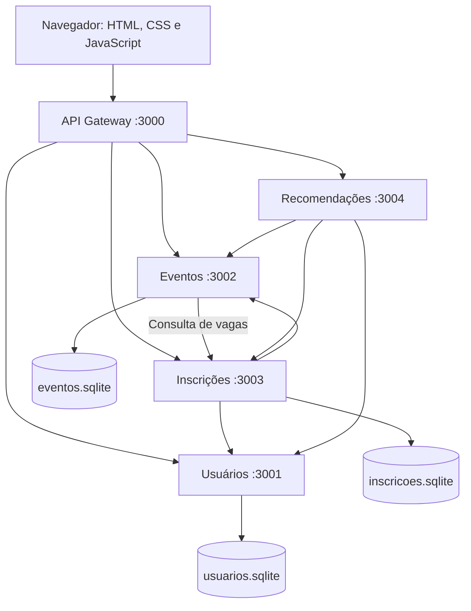

# 4. Arquitetura e tecnologias

Definimos esta arquitetura para implementar a versão mínima do nosso sistema. Ela descreve decisões de projeto; os serviços ainda não estão implementados.

Atualização após a Sprint 1: Gateway, Usuários, Eventos e interface estão implementados, com execução por `npm start`. Inscrições e Recomendações continuam planejados. A indicação original acima e as referências a cinco processos descrevem o plano completo; o [registro da Sprint 1](05-registro-sprint1.md) detalha o estado atual, e o README contém os comandos já disponíveis.

Atualização após a Sprint 2: os cinco processos estão implementados, incluindo vagas, inscrições e recomendações. O [registro da Sprint 2](06-registro-sprint2.md) e o README descrevem o estado atual. As indicações anteriores de componentes ainda planejados são históricas; os contratos descritos abaixo foram aplicados nesta implementação.

## Tecnologias escolhidas

| Parte | Tecnologia | Motivo |
| --- | --- | --- |
| Gateway e quatro serviços | JavaScript, Node.js 24.19.0 e Express 5 | Uma linguagem para toda a aplicação, com rotas HTTP simples. |
| Persistência | SQLite por meio de `node:sqlite` | Bancos em arquivos locais, sem instalar um servidor de banco separado. |
| Interface | HTML, CSS e JavaScript com módulos nativos | Telas pequenas, sem etapa de compilação. |
| Comunicação | HTTP, JSON e `fetch` | Mesma forma de comunicação na interface e entre serviços. |
| Verificação | `node:test` e testes de integração HTTP | Verificar regras e fluxo completo usando o próprio Node.js. |
| Código e execução | Git, GitHub, npm e script Node.js para iniciar processos | Entrega reproduzível e comando único de inicialização. |

O ambiente local foi verificado com Node.js v24.19.0 e uma consulta SQLite em memória. Essa verificação confirma a disponibilidade do recurso, mas não representa um teste do sistema. Express será instalado e sua versão exata ficará registrada no package-lock.json durante a implementação. O módulo `node:sqlite` ainda é classificado como release candidate na documentação da linha 24; usaremos a versão de Node verificada para a entrega acadêmica local.

## Desenho da arquitetura



Cada caixa de serviço será um processo independente. O Gateway também servirá os arquivos da interface, mantendo o navegador e as APIs na mesma origem. Todos os processos escutarão em 127.0.0.1 para a demonstração local. Não será necessário Docker nesta versão.

## Serviços, portas e bancos

| Processo | Porta padrão | Banco | Responsabilidade |
| --- | --- | --- | --- |
| Gateway | 3000 | Nenhum | Servir a interface, encaminhar chamadas e consultar o estado dos serviços. |
| Usuários | 3001 | data/usuarios.sqlite | Cadastrar, listar e consultar participantes. |
| Eventos | 3002 | data/eventos.sqlite | Cadastrar eventos e consultar seus dados; enriquecer listagens com vagas. |
| Inscrições | 3003 | data/inscricoes.sqlite | Registrar inscrições, contar ocupação e listar inscrições. |
| Recomendações | 3004 | Nenhum | Aplicar a regra de recomendação consultando os demais serviços. |

Somente o serviço proprietário acessará seu banco. IDs entre serviços serão referências lógicas, validadas por HTTP, sem consultas diretas a outros arquivos de banco. As portas e URLs internas serão configuráveis por variáveis de ambiente.

## Modelo de dados

- `participantes`: `id` inteiro gerado, `nome`, `email` normalizado e único, `area`.
- `eventos`: `id` inteiro gerado, `titulo`, `descricao`, `inicio` em ISO 8601 UTC, `local`, `area`, `capacidade` inteira positiva.
- `inscricoes`: `id` inteiro gerado, `participanteId`, `eventoId`, `criadaEm` em UTC; restrição única em (`participanteId`, `eventoId`).

As áreas serão os textos definidos nos requisitos. A interface converterá a entrada em horário de Brasília para um instante ISO com fuso explícito e exibirá os resultados em America/Sao_Paulo. A API rejeitará datas sem indicação de fuso.

## Contratos das APIs

O navegador utilizará somente as rotas públicas abaixo. IDs serão inteiros positivos. Corpos e respostas usarão JSON, exceto arquivos estáticos da interface.

| Método e rota no Gateway | Serviço e rota de destino | Entrada / resposta de sucesso |
| --- | --- | --- |
| POST /api/participantes | Usuários: POST /participantes | `{nome,email,area}` → participante criado, 201. |
| GET /api/participantes | Usuários: GET /participantes | Lista de participantes, 200. |
| GET /api/participantes/:id | Usuários: GET /participantes/:id | Participante, 200. |
| POST /api/eventos | Eventos: POST /eventos | `{titulo,descricao,inicio,local,area,capacidade}` → evento criado, 201. |
| GET /api/eventos | Eventos: GET /eventos | Lista com dados dos eventos e `vagasDisponiveis`, 200. |
| GET /api/eventos/:id | Eventos: GET /eventos/:id | Dados básicos do evento, sem consultar Inscrições, 200. |
| POST /api/inscricoes | Inscrições: POST /inscricoes | `{participanteId,eventoId}` → inscrição criada, 201. |
| GET /api/inscricoes?participanteId=1 | Inscrições: GET /inscricoes?participanteId=1 | Lista com inscrições e seus dados de evento, 200. |
| GET /api/recomendacoes?participanteId=1 | Recomendações: GET /recomendacoes?participanteId=1 | Lista de eventos elegíveis com vagas, 200. |
| GET /api/status | Gateway: agregação de GET /health dos quatro serviços | Lista com nome, porta e estado de cada serviço, 200, mesmo com algum indisponível. |

Cada processo terá `GET /health`, com `{status:"ok",servico:"nome"}` e código 200 enquanto estiver apto a atender; serviços com banco verificarão uma consulta simples. Falha local de banco retornará 503. O estado não depende de todos os outros serviços estarem disponíveis.

Rotas internas adicionais de Inscrições:

- `GET /ocupacao`: lista de `{eventoId,total}`; eventos ausentes têm ocupação zero. Consulta apenas seu banco, sem chamadas a Eventos.
- `GET /inscricoes/ids?participanteId=1`: lista de IDs de eventos em que o participante está inscrito, sem enriquecer dados de eventos.

Essas rotas não terão encaminhamento público no Gateway. `GET /eventos/:id` e as rotas internas sem enriquecimento evitam chamadas circulares: Eventos consulta ocupação sem gerar uma nova consulta a Eventos.

Respostas individuais terão o formato `{dados: objeto}` e listas `{dados: []}`. Erros terão `{erro:{codigo:"CODIGO",mensagem:"Descrição compreensível"}}`. O Gateway preservará respostas de negócio dos serviços.

| HTTP | Utilização |
| --- | --- |
| 400 | JSON inválido, campos ou parâmetros inválidos. |
| 404 | Participante, evento ou rota inexistente. |
| 409 | E-mail repetido, inscrição duplicada, evento iniciado ou sem vagas. |
| 503 | Dependência necessária indisponível ou consulta de banco indisponível. |
| 504 | Tempo limite de chamada HTTP excedido. |
| 500 | Erro interno inesperado, sem expor detalhes técnicos ao usuário. |

IDs inexistentes na consulta de inscrições ou recomendações retornarão 404; participante existente sem resultados receberá uma lista vazia. A validação será realizada no servidor, mesmo quando também existir na interface.

## Fluxos e consistência

### Inscrição e última vaga

1. Inscrições consulta o participante em Usuários e o evento pela rota básica de Eventos.
2. Depois das consultas HTTP, inicia uma transação SQLite `BEGIN IMMEDIATE` em seu próprio banco.
3. Dentro da transação, verifica novamente o horário de início, duplicidade e contagem das inscrições do evento; somente então insere o registro e confirma a transação.
4. Em caso de erro, desfaz a transação. Não haverá chamadas HTTP nem `await` entre o início e o fim dessa transação síncrona.

A contagem e a inserção na mesma transação, junto da restrição única, impedirão duas confirmações para a última vaga. A capacidade vem do cadastro de Eventos e não muda nesta versão, que não oferece edição. Não haverá um contador de vagas separado para sincronizar entre bancos.

### Listagens e recomendações

Eventos obtém a ocupação em Inscrições e calcula `capacidade - total`. Recomendações consulta o participante, os eventos com vagas e os IDs das inscrições, filtrando por área, início futuro, vaga e ausência de inscrição. As sugestões serão ordenadas pela data de início e, em empate, pelo ID.

A listagem representa o estado no momento da consulta. A disponibilidade será validada novamente ao confirmar uma inscrição. Se uma dependência necessária falhar, a operação retornará erro; o sistema não inventará vagas nem retornará uma lista vazia como se a consulta tivesse funcionado.

Chamadas internas terão tempo limite de 3 segundos; o Gateway terá limite de 10 segundos para operações agregadas. Não haverá repetição automática de POST. Na Sprint 1, enquanto Inscrições ainda não existir, a consulta de vagas será explicitamente parcial; o comportamento final descrito aqui será integrado na Sprint 2.

## Estrutura prevista do repositório

```text
gateway/server.js
services/usuarios/server.js
services/eventos/server.js
services/inscricoes/server.js
services/recomendacoes/server.js
shared/                 # validação, HTTP e lista de áreas, sem acesso cruzado a bancos
frontend/index.html
frontend/styles.css
frontend/app.js
frontend/components/    # campo de formulário e cartão de evento
frontend/api.js         # cliente compartilhado do Gateway
scripts/start.js        # inicia cinco processos e encerra os filhos ao sair
tests/                  # verificações de regras e integração
data/                   # três bancos locais gerados na execução
docs/
fontes/
package.json
package-lock.json
README.md
relatorio.txt
```

Essa estrutura é um plano, não uma lista de arquivos já implementados. Os bancos e as dependências instaladas ficarão fora do Git. O comando previsto será `npm install` seguido de `npm start`, com acesso a http://127.0.0.1:3000. Esses comandos só estarão disponíveis após a implementação dos scripts.

## Verificações previstas

Vamos conferir encaminhamento pelo Gateway, persistência após reinício, cadastros inválidos, duplicidade, inscrição após início, concorrência pela última vaga, filtros de recomendação e falhas de dependências. A tela de estado será usada junto da listagem dos processos para registrar a execução dos serviços. Não há testes de aplicação executados nesta etapa.

## Referências técnicas consultadas

- Express: instalação e requisito de Node.js — https://expressjs.com/en/starter/installing/
- Node.js 24: SQLite e DatabaseSync — https://nodejs.org/download/release/latest-v24.x/docs/api/sqlite.html

As tecnologias são escolhas da dupla para atender ao escopo; não foram impostas pelo professor.
