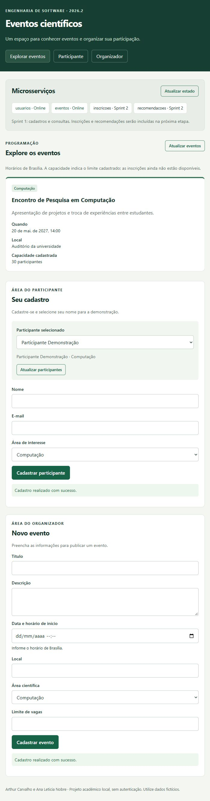

# Registro técnico — Sprint 1

Data do registro: 31/10/2026. Este documento registra a implementação e as verificações realizadas no ambiente do projeto, sem atribuir reuniões ou retrospectivas não realizadas à dupla.

## Resultado

- Gateway na porta 3000, com rotas públicas e arquivos da interface.
- Serviço de usuários na porta 3001, com SQLite próprio, cadastro, consulta, normalização de e-mail e restrição de unicidade.
- Serviço de eventos na porta 3002, com SQLite próprio, cadastro e consulta, validação de data com fuso, calendário, campos e capacidade.
- Interface com listagens, estados vazios, formulários, seleção do participante e mensagens de erro e sucesso.
- Identificação de Usuários e Eventos como online ou indisponíveis. Inscrições e Recomendações são identificados como planejados para a Sprint 2.
- Componentes de campo e cartão de evento, cliente HTTP e validações compartilhadas.
- Inicializador dos processos, lockfile de dependências e instruções no README.

## Situação do Sprint Backlog

| Item | Situação técnica |
| --- | --- |
| S1-01 — Arquitetura e contratos | Documentados em 04-arquitetura-e-tecnologias.md. |
| S1-02 — Repositório, Gateway e serviços | Implementados. Publicação no GitHub fica para a entrega. |
| S1-03 — Telas e componentes | Implementados e verificados no navegador. |
| S1-04 — Integração e persistência | Verificadas por HTTP com processos separados e reinício dos serviços. |
| S1-05 — Documentação e resultados | README, registro técnico e relatório atualizados. |

PB01 e PB02 estão implementados e verificados nesta etapa. PB03 está parcialmente implementado: consulta dados e capacidade, mas o cálculo de vagas e a relação com inscrições dependem da Sprint 2. PB04 a PB06 continuam A fazer.

## Verificações executadas

`npm test` passou com 10 testes reportados pelo executor Node.js: um teste principal e nove subtestes, sem falhas.

1. Arquivos da interface e componentes entregues pelo Gateway; listas inicialmente vazias.
2. Cadastro válido de participante, e-mail normalizado, consulta individual e listagem.
3. Recusa de e-mail duplicado, nome vazio, e-mail inválido, área inválida e corpos sem os campos obrigatórios.
4. Cadastro e consulta de evento, capacidade e indicação explícita de disponibilidade ainda parcial.
5. Recusa de data passada, data sem fuso, data inexistente, capacidade inválida e campos vazios.
6. IDs inválidos, registros inexistentes, rota inexistente, JSON malformado e método não permitido.
7. Estado dos serviços online e dos serviços ainda planejados.
8. Encerramento e reinício de Usuários e Eventos, seguido de consulta dos mesmos registros persistidos.
9. Interrupção de Usuários, com retorno 503 pelo Gateway e Eventos ainda respondendo.

Os testes usam bancos e portas temporários. A consulta SQLite em memória feita na preparação foi complementada aqui por testes com bancos em arquivo e reinício de processos.

## Verificação no navegador

Foram cadastrados dados fictícios pela interface: Participante Demonstração e Encontro de Pesquisa em Computação, em 20/05/2027 às 14h de Brasília, com capacidade 30. O evento apareceu na programação e o participante ficou selecionado. Uma tentativa de repetir o e-mail foi recusada com mensagem compreensível. Após recarregar a página, o evento e a seleção permaneceram disponíveis.

A captura comprova a interface desta etapa, com dois microsserviços ativos; não é uma evidência dos quatro microsserviços em execução exigida para a entrega final. Essa evidência será produzida após a Sprint 2.

## Limitações e continuidade

Não há inscrições, recomendações nem consulta real de vagas. A API retorna `vagasDisponiveis: null` na listagem e um aviso em `meta`; a interface apresenta somente a capacidade cadastrada. Não foi usada uma contagem fictícia para substituir a integração futura.

Os componentes de campo e cliente HTTP já são compartilhados pelos cadastros; o cartão está preparado para ser reutilizado nas recomendações. A documentação da arquitetura descreve também partes futuras, identificadas como plano.

Próxima etapa: implementar Inscrições e Recomendações, integrar ocupação de vagas e executar os critérios de aceitação da Sprint 2, incluindo concorrência pela última vaga.
