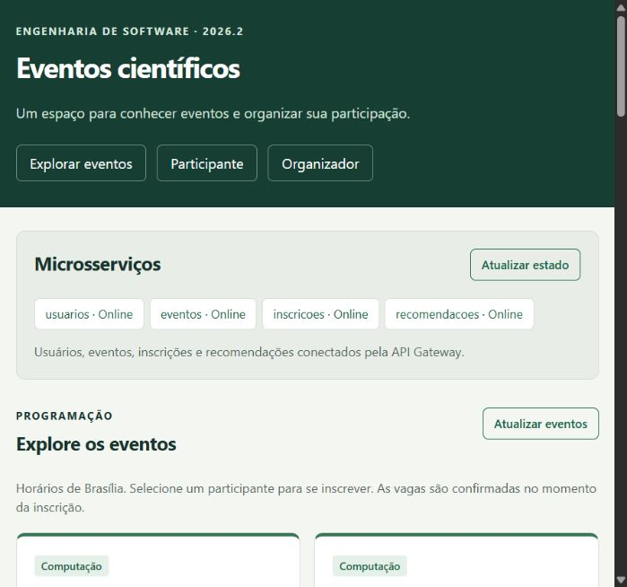
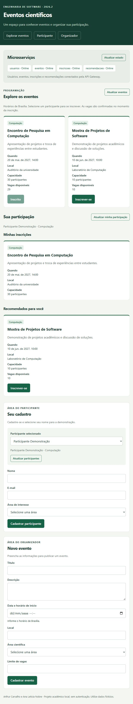

# Especificação do código e demonstração

## API Gateway

`gateway/server.js` cria o processo HTTP na porta 3000. Entrega `frontend/` por arquivos estáticos e encaminha somente as rotas públicas permitidas para os serviços. Preserva códigos e mensagens das respostas, sem repetir POST. O limite de encaminhamento é 10 segundos; falhas de conexão geram 503 e tempo excedido gera 504. `/api/status` consulta `/health` em paralelo e identifica cada serviço como online ou indisponível.

## Microsserviços

| Serviço / arquivo | Entradas e operações | Persistência |
| --- | --- | --- |
| Usuários — `services/usuarios/server.js` | POST /participantes valida nome, e-mail e área; normaliza e-mail. GET /participantes lista; GET /participantes/:id consulta ou retorna 404. | usuarios.sqlite: participantes(id, nome, email UNIQUE, area). |
| Eventos — `services/eventos/server.js` | POST /eventos valida dados, início com fuso e capacidade. GET /eventos agrega ocupação para calcular vagas; GET /eventos/:id retorna cadastro básico. | eventos.sqlite: eventos(id, titulo, descricao, inicio, local, area, capacidade). |
| Inscrições — `services/inscricoes/server.js` | POST /inscricoes valida referências por HTTP e confirma atomicamente. GET /inscricoes?participanteId lista registros do participante e consulta dados dos eventos. GET /ocupacao e /inscricoes/ids são rotas internas sem encaminhamento no Gateway. | inscricoes.sqlite: inscricoes(id, participanteId, eventoId, criadaEm), UNIQUE(participanteId, eventoId). |
| Recomendações — `services/recomendacoes/server.js` | GET /recomendacoes?participanteId consulta interesse, eventos e inscrições, aplica filtros e ordena. | Sem banco; sugestões calculadas a cada consulta. |

Todos usam `application` e `errors` de `shared/core.js`, com JSON de até 32 KB, rota `/health` e respostas de erro uniformes. Bancos e tabelas são criados automaticamente. SQL usa parâmetros para valores recebidos. Somente o proprietário acessa cada arquivo de banco.

As regras, contratos, códigos HTTP, campos e diagrama estão em [Arquitetura](04-arquitetura-e-tecnologias.md). Não existem rotas de edição, exclusão ou cancelamento. A referência a participante não é autenticação: trata-se de uma demonstração local.

## Inscrição e recomendação

Na inscrição, as consultas de existência acontecem antes de `BEGIN IMMEDIATE`. Sem await dentro da transação, a rotina verifica início, duplicidade e contagem, insere e executa COMMIT. Um erro executa ROLLBACK. Essa operação impede ultrapassar a capacidade, e a restrição UNIQUE também protege o par participante/evento. O evento não pode ser editado nesta versão, portanto a capacidade não muda entre validação e confirmação.

A recomendação implementada em `services/recomendacoes/server.js` usa a regra:

`mesma área && início futuro && vagas > 0 && participante ainda não inscrito`.

A ordenação é por início e ID. `shared/http.js` limita consultas internas a três segundos e propaga falhas sem convertê-las em listas vazias. A rota de ocupação não chama Eventos; a consulta básica de evento não chama Inscrições. Assim, a dependência de dados não se transforma em recursão HTTP.

## Componentes de software e reuso

| Componente | Contrato / uso |
| --- | --- |
| `frontend/components/field.js` — field(especificacao) | Retorna um campo DOM com label, validação HTML e opções. Reutilizado nos cadastros de participante e evento. |
| `frontend/components/event-card.js` — eventCard(evento, opcoes) | Retorna cartão DOM com informações do evento e ação opcional de inscrição. Usado na programação, nas inscrições e nas sugestões. |
| `frontend/api.js` — api(caminho, opcoes) | Cliente HTTP único da interface, com JSON, tempo limite e tratamento de erro; acessa somente o Gateway. |
| `shared/core.js` | Valida texto, área e ID; abre bancos próprios; configura HTTP, erros e ciclo de vida. Usado pelos processos. |
| `shared/http.js` — get(servico, caminho) | Cliente HTTP interno com URLs configuráveis e falhas padronizadas. Usado por Eventos, Inscrições e Recomendações. |

Também há reuso de bibliotecas: Express e SQLite via Node.js. Os serviços reutilizam infraestrutura, mantendo dados e regras de negócio em seus próprios módulos. Conteúdo recebido é apresentado com textContent, sem interpretar texto cadastrado como HTML.

## Telas e roteiro explicado

1. **Página principal e serviços:** identifica a aplicação e consulta o estado real de Usuários, Eventos, Inscrições e Recomendações. A API Gateway é o ponto de acesso da página.
2. **Cadastro e seleção do participante:** permite informar nome, e-mail e interesse. O cadastro salvo aparece na seleção. O participante selecionado identifica a pessoa da demonstração; não é um login.
3. **Cadastro de evento:** o organizador informa título, descrição, início futuro em Brasília, local, área e capacidade. Validações são feitas na interface e repetidas no servidor.
4. **Programação:** cartões apresentam data, local, área, capacidade e vagas. Selecionar Inscrever-se envia a solicitação ao serviço de Inscrições por meio do Gateway. Sem seleção, em evento iniciado ou lotado, a ação fica desabilitada; o servidor também valida.
5. **Minhas inscrições:** mostra apenas eventos do participante selecionado. A troca de seleção limpa a visão anterior e carrega os registros correspondentes. Na ausência de registros, informa que não há inscrições.
6. **Recomendados para você:** reutiliza o cartão e sugere eventos elegíveis. Depois de uma inscrição, as listas são atualizadas e o evento escolhido sai das sugestões.

As capturas mostram dados fictícios e o funcionamento verificado nas sprints. Para nova demonstração, utilizar datas futuras. A instalação e os comandos estão no README; o roteiro não depende de dados pré-cadastrados.
