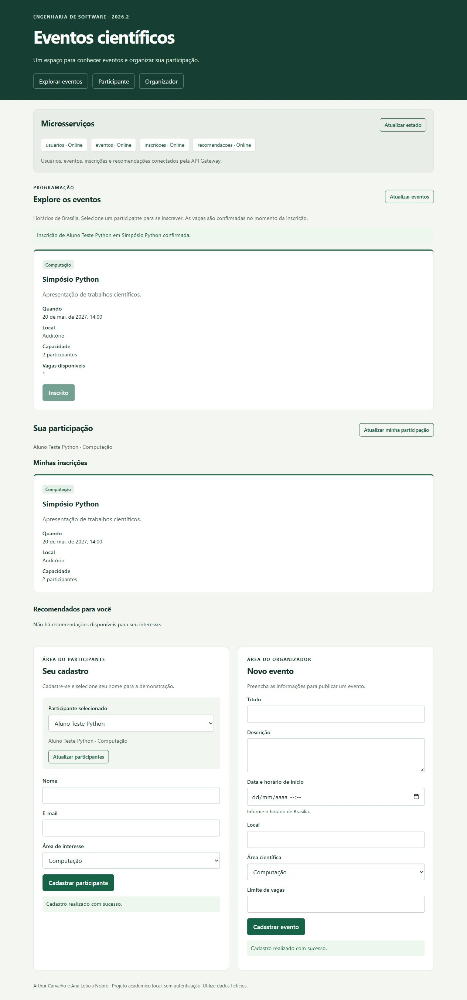

# Integração da interface com o Gateway Python — passo 4

A interface em `frontend/` foi reaproveitada sem alterações no código. Suas chamadas são relativas a `/api`, e o Gateway Python manteve as rotas, os formatos JSON e os códigos HTTP necessários. O Gateway entrega os mesmos arquivos HTML, CSS e JavaScript pela porta configurada.

Foi iniciado um conjunto com os cinco processos Python em portas 3200 a 3204, usando bancos temporários fora dos bancos da versão Node.js. A tela principal mostrou Usuários, Eventos, Inscrições e Recomendações online.

Pelo navegador, cadastramos o participante fictício Aluno Teste Python, com interesse em Computação, e o evento Simpósio Python, com capacidade para duas pessoas. Antes da inscrição, o evento apareceu na programação e nas recomendações com duas vagas. Após confirmar a inscrição, a programação mostrou uma vaga, o evento apareceu em Minhas inscrições e deixou de ser recomendado para o participante. O botão passou a indicar Inscrito.

O teste de integração dos serviços Python também passou. A revisão completa dos demais critérios, a atualização do relatório de entrega e a decisão de substituir a branch principal pertencem aos próximos passos.
